# Лаба 4 — SLA критического пути под перегрузкой

>
> Сгенерировали код, который чисто создает процессы и жрет память. Вот прям жрёт
>

## Часть 1. Механизм разнесения

Тут нужно настроить распределение реплик между нодами для отказоустойчивости при выходе одной (нескольких) нод из строя.

Есть два варианта:
- `podAntiAffinity`, который позволяет запретить совместное размешение определенных подов на одной ноде
- `topologySpreadConstraints`, который позволяет равномерно размещать реплики между нодами

Мы выбрали второй вариант, так как в таком случае мы сможем равномерно распределить критически важный сервис между доступными нодами (а у нас их ограничено - будет их 2). У нас реплик api всего 6, поэтому мы получим 3 api на каждой ноде. В ином случае мы бы получили по одному api на ноду, а другие висели бы в pending, что звучит не очень хорошо

По настройкам. В [values.yaml](k8s/shop-chart/values.yaml) мы настраиваем:

```yaml
  placement:
    mode: topologySpreadConstraints     # режим
    topologyKey: kubernetes.io/hostname # ключ для распределения (по хостнейму ноды)
    maxSkew: 1  # допустимая разница в количестве реплик между нодами
```


И обновим шаблон [деплоймента апи](k8s/shop-chart/templates/api-deployment.yaml):
```yaml
spec:
    {{- if eq .Values.api.placement.mode "topologySpreadConstraints" }}
    topologySpreadConstraints:
      - maxSkew: {{ .Values.api.placement.maxSkew }}
        topologyKey: {{ .Values.api.placement.topologyKey | quote }}
        nodeTaintsPolicy: Honor # учет taint (для control plane)
        whenUnsatisfiable: DoNotSchedule # строгое правило для равномерного распределения, иначе pending
        labelSelector:
          matchLabels:
            app: api

    {{- else if eq .Values.api.placement.mode "podAntiAffinity" }}
    affinity:
      podAntiAffinity:
        preferredDuringSchedulingIgnoredDuringExecution: # не строгое правило при запуске пода (не трогать запущенные)
          - labelSelector:
              matchLabels:
                app: api
            topologyKey: {{ .Values.api.placement.topologyKey | quote }}
    {{- end }}
```

В `podAntiAffinity` используется не строгое правило `preferredDuringSchedulingIgnoredDuringExecution`. При нем кубер будет пытаться разнести реплики на разных нодах. Если вдруг где-то ресурсов например не хватит, то разместит на одной. В целом это повысит доступность api, в сравнении с `requiredDuringSchedulingIgnoredDuringExecution`

Проверка шаблона:

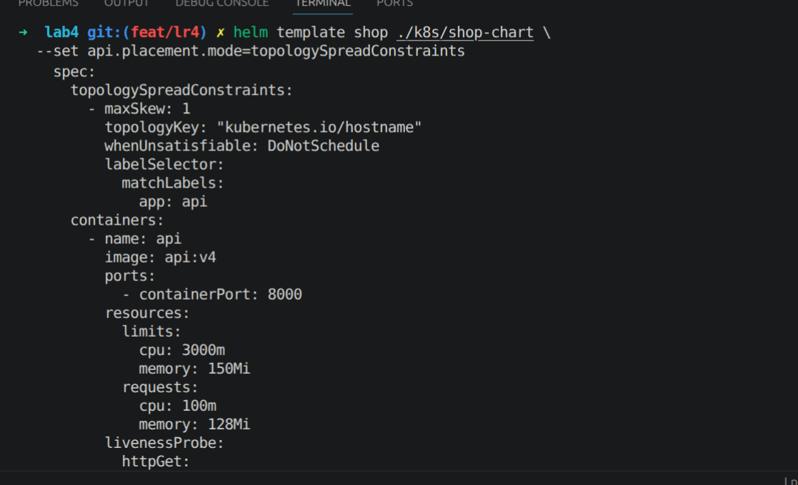

---

## Часть 2. Тесная площадка

Меняем наш кластер [конфиг](k8s/cluster-config.yaml) на 2 воркер ноды + control plane (не размещаем тут поды, запрещаем):

```yaml
kind: Cluster
apiVersion: kind.x-k8s.io/v1alpha4
nodes:
  - role: control-plane
    kubeadmConfigPatches:
      - |
        kind: InitConfiguration
        nodeRegistration:
          taints:
            - key: c-plane
              value: reserved
              effect: NoSchedule

  - role: worker
  - role: worker
```

Создаем кластер:

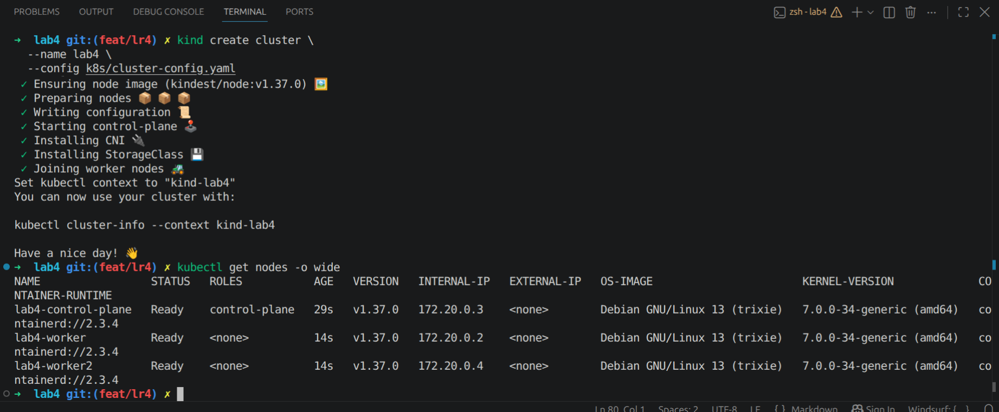

Загружаем образы:

```bash
➜  lab4 git:(feat/lr4) ✗ kind load docker-image api:v5 worker:v2 --name lab4
Image: "api:v5" with ID "sha256:e4669f7d092b51eb17f81eb9b2033fd93b959f6115cf763064ec9c68747eb9f1" not yet present on node "lab4-worker2", loading...
Image: "api:v5" with ID "sha256:e4669f7d092b51eb17f81eb9b2033fd93b959f6115cf763064ec9c68747eb9f1" not yet present on node "lab4-worker", loading...
Image: "api:v5" with ID "sha256:e4669f7d092b51eb17f81eb9b2033fd93b959f6115cf763064ec9c68747eb9f1" not yet present on node "lab4-control-plane", loading...
Image: "worker:v2" with ID "sha256:7eec0f49b59d81f352bcb22ec161382610e08d12bba8437b135010259729d3f2" not yet present on node "lab4-worker2", loading...
Image: "worker:v2" with ID "sha256:7eec0f49b59d81f352bcb22ec161382610e08d12bba8437b135010259729d3f2" not yet present on node "lab4-worker", loading...
Image: "worker:v2" with ID "sha256:7eec0f49b59d81f352bcb22ec161382610e08d12bba8437b135010259729d3f2" not yet present on node "lab4-control-plane", loading...
➜  lab4 git:(feat/lr4) ✗ kind load docker-image batch:v1 --name lab4
Image: "batch:v1" with ID "sha256:6058d4cb74f0de467e8fd9f271f1d406390ccac0c9bb437f935e2fa9e61628be" not yet present on node "lab4-worker2", loading...
Image: "batch:v1" with ID "sha256:6058d4cb74f0de467e8fd9f271f1d406390ccac0c9bb437f935e2fa9e61628be" not yet present on node "lab4-worker", loading...
Image: "batch:v1" with ID "sha256:6058d4cb74f0de467e8fd9f271f1d406390ccac0c9bb437f935e2fa9e61628be" not yet present on node "lab4-control-plane", loading...
```

Так как у нас кластер новый, то установили инфру из предыдущих лаб (CloudNativePG, kube-prometheus-stack, Kyverno). А после установки киверно повторно применили политики из ЛР3:

```bash
➜  lab4 git:(feat/lr4) ✗ kubectl apply -f k8s/kyverno-polices/
Warning: kyverno.io/v1 ClusterPolicy is deprecated and will be removed in a future release; migrate to ValidatingPolicy, MutatingPolicy, GeneratingPolicy or ImageValidatingPolicy (policies.kyverno.io), see https://kyverno.io/docs/guides/migration-to-cel/
clusterpolicy.kyverno.io/disallow-privileged created
clusterpolicy.kyverno.io/req-labels created
clusterpolicy.kyverno.io/req-limits-requests created
clusterpolicy.kyverno.io/req-probs created
clusterpolicy.kyverno.io/req-user-no-root created
```

Добавим batch новым шаблоном в чарт shop [тык](k8s/shop-chart/templates/batch-deployment.yaml). И его конфигурацию в values:

```yaml
batch:
  replicas: 1
  image: batch:v1
  port: 8082

  resources:
    requests:
      cpu: "100m"
      memory: "512Mi"
    limits:
      cpu: "3000m"
      memory: "512Mi"

  config:
    memMb: 256
    cpuWorkers: 1
    growStepMb: 16
    growIntervalS: 2
    logIntervalS: 5
```


И устанавливаем наш shop-chart:

```bash
➜  lab4 git:(feat/lr4) ✗ helm install shop ./k8s/shop-chart -n default
NAME: shop
LAST DEPLOYED: Mon Oct 12 00:20:13 2026
NAMESPACE: default
STATUS: deployed
REVISION: 1
TEST SUITE: None
➜  lab4 git:(feat/lr4) ✗ helm list -n default
NAME    NAMESPACE       REVISION        UPDATED                                 STATUS          CHART           APP VERSION
shop    default         1               2026-10-12 00:20:13.961561271 +0300 MSK deployed        shop-1.0.0      1.0        
➜  lab4 git:(feat/lr4) ✗ 
```

Смотрим распределение наших реплик апи по нодам:

```bash
➜  lab4 git:(feat/lr4) ✗ kubectl get pods -l app=api -o wide
NAME                   READY   STATUS    RESTARTS   AGE   IP            NODE           NOMINATED NODE   READINESS GATES
api-8545dfd96f-6n99x   1/1     Running   0          50s   10.244.2.36   lab4-worker    <none>           <none>
api-8545dfd96f-8mqm2   1/1     Running   0          62s   10.244.1.26   lab4-worker2   <none>           <none>
api-8545dfd96f-bb8hl   1/1     Running   0          62s   10.244.2.34   lab4-worker    <none>           <none>
api-8545dfd96f-sss2q   1/1     Running   0          51s   10.244.1.29   lab4-worker2   <none>           <none>
api-8545dfd96f-x4pqn   1/1     Running   0          62s   10.244.1.27   lab4-worker2   <none>           <none>
```

Видим, что реплики распределились 3 на 3 на двух нодах. Наш `batch` тоже работает:

```bash
➜  lab4 git:(feat/lr4) ✗ kubectl logs deployment/batch --tail=20
[batch-8554c4449d-t8qk5] mem=16MB growing
[batch-8554c4449d-t8qk5] mem=32MB growing
[batch-8554c4449d-t8qk5] mem=48MB growing
[batch-8554c4449d-t8qk5] mem=64MB growing
[batch-8554c4449d-t8qk5] mem=80MB growing
[batch-8554c4449d-t8qk5] mem=96MB growing
[batch-8554c4449d-t8qk5] mem=112MB growing
[batch-8554c4449d-t8qk5] mem=128MB growing
[batch-8554c4449d-t8qk5] mem=144MB growing
[batch-8554c4449d-t8qk5] mem=160MB growing
[batch-8554c4449d-t8qk5] mem=176MB growing
[batch-8554c4449d-t8qk5] mem=192MB growing
[batch-8554c4449d-t8qk5] mem=208MB growing
[batch-8554c4449d-t8qk5] mem=224MB growing
[batch-8554c4449d-t8qk5] mem=240MB growing
[batch-8554c4449d-t8qk5] mem=256MB growing
[batch-8554c4449d-t8qk5] mem=256MB steady cpu_workers=1
[batch-8554c4449d-t8qk5] mem=256MB steady cpu_workers=1
...
```

## Часть 3. Реальные числа вместо угадывания

Теперь нам нужно понять сколько реально потребляет наш сервис. Будем кидать запросы на POST /order через hey. Устанавливаем сначала hey:

```bash
➜  itmo-devops-labs git:(feat/lr4) ✗ go install github.com/rakyll/hey@latest
go: downloading github.com/rakyll/hey v0.1.5
go: downloading golang.org/x/net v0.48.0
go: downloading golang.org/x/text v0.33.0
```

И запускаем hey:

```bash
~/go/bin/hey \
  -z 5m \ # 5 минут тест
  -c 5 \ # 5 параллельных клиентов
  -q 1 \ # 1 запрос в секунду
  -m POST \
  -T application/json \
  -d '{
    "phone_number": "+79991234567",
    "customer_name": "Load Test",
    "sku": "1234567",
    "quantity": 1
  }' \
  http://localhost:8001/order
```

Результат:

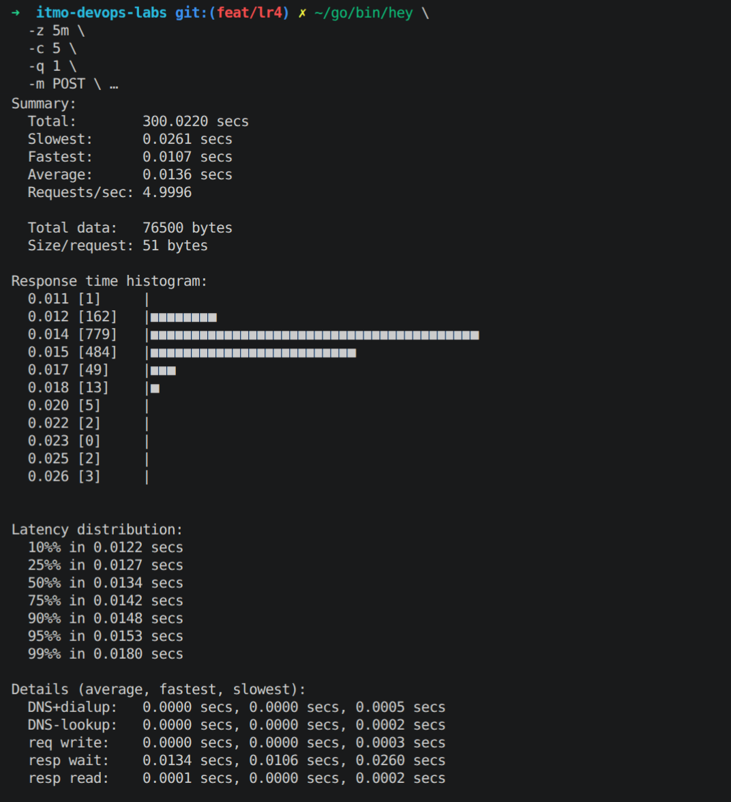

Из резульатов: средняя задержка 13,6 мс, p95=15,3мс, p99=18мс

И запускаем krr:

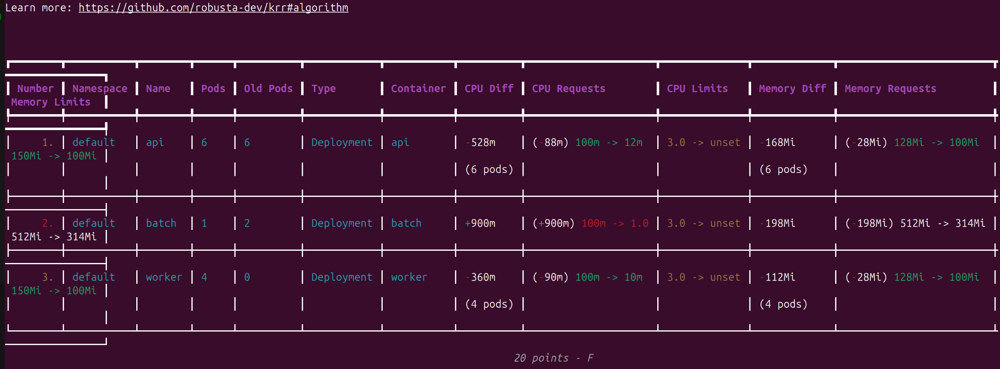

Что у нас получилось:

| Компонент | CPU request: было | CPU request: KRR | Memory request: было | Memory request: KRR | Memory limit: было | Memory limit: KRR |
|---|---:|---:|---:|---:|---:|---:|
| API | 100m | 12m | 128Mi | 100Mi | 150Mi | 100Mi |
| Worker | 100m | 10m | 128Mi | 100Mi | 150Mi | 100Mi |

* С постгрей проблема из-за CloudNativePG. Krr не умеет с этим работать. Поэтому через прометеус были сняты значения CPU requests по 95 перцентилю (получилось около 12.35m), и максимальная память (около 125.85 мб).

Цпу лимиты krr предложил в unset (и правильно).

Попробуем поменять все по рекомендации в values.yaml:

```yaml
api:
  replicas: 6
  image: api:v5
  port: 8000
  placement:
    mode: topologySpreadConstraints
    topologyKey: kubernetes.io/hostname
    maxSkew: 1
  resources:
    requests:
      cpu: "12m"
      memory: "100Mi"
    limits:
      memory: "100Mi"

postgres:
postgres:
  host: postgres-rw
  port: 5432
  database: lab3
  secretName: postgres-app-secret

  resources:
    requests:
      cpu: "13m"
      memory: "145Mi"
    limits:
      memory: "145Mi"

worker:
  replicas: 4
  image: worker:v2
  port: 8081
  resources:
    requests:
      cpu: "10m"
      memory: "100Mi"
    limits:
      memory: "100Mi"


batch:
  replicas: 1
  image: batch:v1
  port: 8082

  resources:
    requests:
      cpu: "100m"
      memory: "512Mi"
    limits:
      cpu: "3000m"
      memory: "512Mi"

  config:
    memMb: 256
    cpuWorkers: 1
    growStepMb: 16
    growIntervalS: 2
    logIntervalS: 5
```

Делаем апгрейд и смотрим что все применилось:

```bash
(.venv) ➜  lab4 git:(feat/lr4) ✗ kubectl get cluster postgres \
  -o jsonpath='{.spec.resources}{"\n"}'
{"limits":{"memory":"145Mi"},"requests":{"cpu":"13m","memory":"145Mi"}}
(.venv) ➜  lab4 git:(feat/lr4) ✗ 

(.venv) ➜  lab4 git:(feat/lr4) ✗ kubectl get deployment api \
  -o jsonpath='{.spec.template.spec.containers[0].resources}{"\n"}'
{"limits":{"memory":"100Mi"},"requests":{"cpu":"12m","memory":"100Mi"}}
(.venv) ➜  lab4 git:(feat/lr4) ✗ 

(.venv) ➜  lab4 git:(feat/lr4) ✗ kubectl get deployment worker \
  -o jsonpath='{.spec.template.spec.containers[0].resources}{"\n"}'
{"limits":{"memory":"100Mi"},"requests":{"cpu":"10m","memory":"100Mi"}}
(.venv) ➜  lab4 git:(feat/lr4) ✗ 

```

В итоге все запустилось:

```bash
(.venv) ➜  lab4 git:(feat/lr4) ✗ kubectl get pods                                                          
NAME                      READY   STATUS    RESTARTS   AGE
api-584884b6c5-hqxrf      1/1     Running   0          8m28s
api-584884b6c5-kr8rh      1/1     Running   0          8m16s
api-584884b6c5-lb77x      1/1     Running   0          8m16s
api-584884b6c5-ldf6c      1/1     Running   0          8m16s
api-584884b6c5-vpvlc      1/1     Running   0          8m28s
api-584884b6c5-xg8jv      1/1     Running   0          8m28s
batch-8554c4449d-t8qk5    1/1     Running   0          55m
postgres-1                1/1     Running   0          5m2s
postgres-2                1/1     Running   0          8m14s
postgres-3                1/1     Running   0          8m26s
worker-5f994df878-28n5h   1/1     Running   0          8m28s
worker-5f994df878-2xw52   1/1     Running   0          8m28s
worker-5f994df878-44hs9   1/1     Running   0          8m16s
worker-5f994df878-phtm7   1/1     Running   0          8m16s
(.venv) ➜  lab4 git:(feat/lr4) ✗ 
```

Если подвести итог, то изначально ресурсы задались ну фактически случайно, больше с запасом и без опоры на метрики. После нагрузочного тестирования видно, что для апи и воркера запас по цпу был большим, а по памяти разница оказалась меньше.

## Часть 4. Разнеси критический сервис

Ну в целом в части 1 мы это уже сделали, но вот еще раз:

```bash
(.venv) ➜  lab4 git:(feat/lr4) ✗ k get pods -o wide         
NAME                      READY   STATUS    RESTARTS   AGE     IP            NODE           NOMINATED NODE   READINESS GATES
api-584884b6c5-hqxrf      1/1     Running   0          9m45s   10.244.2.21   lab4-worker    <none>           <none>
api-584884b6c5-kr8rh      1/1     Running   0          9m33s   10.244.1.24   lab4-worker2   <none>           <none>
api-584884b6c5-lb77x      1/1     Running   0          9m33s   10.244.1.23   lab4-worker2   <none>           <none>
api-584884b6c5-ldf6c      1/1     Running   0          9m33s   10.244.2.24   lab4-worker    <none>           <none>
api-584884b6c5-vpvlc      1/1     Running   0          9m45s   10.244.1.20   lab4-worker2   <none>           <none>
api-584884b6c5-xg8jv      1/1     Running   0          9m45s   10.244.2.20   lab4-worker    <none>           <none>
...
```

Видно что апи поровну по 3 на двух нодах (при падении одной ноды часть реплик останется доступна на второй ноде)

## Часть 5. Приоритеты и гарантии

Теперь рассматриваем priorityClass и PodDisruptionBudget.

priorityClass ставит приоритет поду. Менее приоритетные ноды могут быть вытеснены более приоритетными.

PDB наоборот, выставляет защиту от вытеснения пода при появлении пода с более высоким приоритетом.

QoS Guaranteed ставится в случае requests == limits (cpu/mem). Такие поды сильнее защищены от механизма вытеснения.

QoS Burstable ставится в случае requests < limits (cpu/mem).

Добавляем в values.yaml приоритеты:

```yaml
priorityClasses:
  high: # более высокий приоритет
    name: shop-crit
    value: 1000000

  low: # более низкий приоритет
    name: shop-batch
    value: -10000
```

А также для api меняем ресурсы (добавляем лимиты == реквесты):

```yaml
api:
  replicas: 6
  image: api:v5
  port: 8000

  priorityClassName: shop-crit # ставим класс приоритета
  pdb: # устанавливаем PDB
    enabled: true
    maxUnavailable: 1

  placement:
    mode: topologySpreadConstraints
    topologyKey: kubernetes.io/hostname
    maxSkew: 1
  resources:
    requests:
      cpu: "12m"
      memory: "100Mi"
    limits:
      memory: "100Mi"
      cpu: "12m"
```

Для PG:

```yaml
postgres:
  host: postgres-rw
  port: 5432
  database: lab3
  secretName: postgres-app-secret
  priorityClassName: shop-crit
  pdb:
    enabled: true
  resources:
    requests:
      cpu: "13m"
      memory: "145Mi"
    limits:
      memory: "145Mi"
      cpu: "13m"
```

А для batch ставим Burstable:

```yaml
batch:
  replicas: 1
  image: batch:v1
  port: 8082
  priorityClassName: shop-batch
  resources:
    requests:
      cpu: "100m"
      memory: "128Mi"
    limits:
      cpu: "3000m"
      memory: "512Mi"
```

Создаем темплейт с PriorityClass [priority-classes.yaml](k8s/shop-chart/templates/priority-classes.yaml). И добавляем PriorityClass в [темплейт апи](k8s/shop-chart/templates/api-deployment.yaml):

```yaml
template:
    metadata:
      labels:
        app: api
        environment: dev
    spec:
      priorityClassName: {{ .Values.api.priorityClassName }}
```

Аналогично для batch/postgres.

И добавляем PDB для [темплейта апи](k8s/shop-chart/templates/api-pdb.yaml).

Делаем апгрейд и проверяем что получилось:

```bash
^C%                                                                                                                                                  
(.venv) ➜  lab4 git:(feat/lr4) ✗ kubectl get pods -w
NAME                      READY   STATUS    RESTARTS      AGE
api-54cb9dc474-68g6r      0/1     Running   1 (15s ago)   75s
api-54cb9dc474-k2zkp      0/1     Running   1 (15s ago)   75s
api-54cb9dc474-q6sc5      0/1     Running   1 (15s ago)   75s
api-584884b6c5-hqxrf      1/1     Running   0             36m
api-584884b6c5-lb77x      1/1     Running   0             36m
api-584884b6c5-ldf6c      1/1     Running   0             36m
api-584884b6c5-vpvlc      1/1     Running   0             36m
api-584884b6c5-xg8jv      1/1     Running   0             36m
batch-f47c987df-cjtxr     1/1     Running   0             75s
postgres-1                1/1     Running   0             33m
postgres-2                1/1     Running   0             36m
postgres-3                0/1     Running   0             74s
worker-5f994df878-28n5h   1/1     Running   0             36m
worker-5f994df878-2xw52   1/1     Running   0             36m
worker-5f994df878-44hs9   1/1     Running   0             36m
worker-5f994df878-phtm7   1/1     Running   0             36m
```

Видим, что апи подам плохо:

```bash
Events:
  Type     Reason     Age                   From               Message
  ----     ------     ----                  ----               -------
  Normal   Scheduled  2m35s                 default-scheduler  Successfully assigned default/api-54cb9dc474-68g6r to lab4-worker2
  Normal   Pulled     35s (x3 over 2m32s)   kubelet            spec.containers{api}: Container image "api:v5" already present on machine and can be accessed by the pod
  Normal   Created    35s (x3 over 2m32s)   kubelet            spec.containers{api}: Container created
  Normal   Started    32s (x3 over 2m29s)   kubelet            spec.containers{api}: Container started
  Warning  Unhealthy  31s (x18 over 2m29s)  kubelet            spec.containers{api}: Readiness probe failed: Get "http://10.244.1.27:8000/health": dial tcp 10.244.1.27:8000: connect: connection refused
  Warning  Unhealthy  25s (x7 over 2m25s)   kubelet            spec.containers{api}: Liveness probe failed: Get "http://10.244.1.27:8000/health": dial tcp 10.244.1.27:8000: connect: connection refused
  Normal   Killing    5s (x3 over 2m5s)     kubelet            spec.containers{api}: Container api failed liveness probe, will be restarted
```

Это наверняка из-за лимита цпу в 12m. Поднимем все-таки хотя бы до 100m. Аналогично postgres поднимем цпу. В результате:

```bash
(.venv) ➜  lab4 git:(feat/lr4) ✗ kubectl get pods -w
NAME                      READY   STATUS    RESTARTS   AGE
api-58cc4d65b6-hr2kv      1/1     Running   0          7m4s
api-58cc4d65b6-nbc5h      1/1     Running   0          7m4s
api-58cc4d65b6-pdvdf      1/1     Running   0          7m25s
api-58cc4d65b6-rptzv      1/1     Running   0          7m25s
api-58cc4d65b6-tggl6      1/1     Running   0          7m3s
api-58cc4d65b6-w7vvk      1/1     Running   0          7m25s
batch-f47c987df-cjtxr     1/1     Running   0          12m
postgres-1                1/1     Running   0          23s
postgres-2                1/1     Running   0          3m37s
postgres-3                1/1     Running   0          3m49s
worker-5f994df878-28n5h   1/1     Running   0          47m
worker-5f994df878-2xw52   1/1     Running   0          47m
worker-5f994df878-44hs9   1/1     Running   0          47m
worker-5f994df878-phtm7   1/1     Running   0          47m
```

Посмотрим, что получилось по QoS:

```bash
(.venv) ➜  lab4 git:(feat/lr4) ✗ kubectl get pods -o custom-columns='NAME:.metadata.name,QOS:.status.qosClass,PRIORITY:.spec.priorityClassName'
NAME                      QOS          PRIORITY
api-58cc4d65b6-hr2kv      Guaranteed   shop-crit
api-58cc4d65b6-nbc5h      Guaranteed   shop-crit
api-58cc4d65b6-pdvdf      Guaranteed   shop-crit
api-58cc4d65b6-rptzv      Guaranteed   shop-crit
api-58cc4d65b6-tggl6      Guaranteed   shop-crit
api-58cc4d65b6-w7vvk      Guaranteed   shop-crit
batch-f47c987df-cjtxr     Burstable    shop-batch
postgres-1                Guaranteed   shop-crit
postgres-2                Guaranteed   shop-crit
postgres-3                Guaranteed   shop-crit
worker-5f994df878-28n5h   Burstable    <none>
worker-5f994df878-2xw52   Burstable    <none>
worker-5f994df878-44hs9   Burstable    <none>
worker-5f994df878-phtm7   Burstable    <none>
(.venv) ➜  lab4 git:(feat/lr4) ✗ 
```

И также глянем PDB:

```bash
(.venv) ➜  lab4 git:(feat/lr4) ✗ kubectl get pdb 
NAME               MIN AVAILABLE   MAX UNAVAILABLE   ALLOWED DISRUPTIONS   AGE
api-pdb            N/A             1                 1                     13m
postgres           1               N/A               1                     44h
postgres-primary   1               N/A               0                     44h
```

Если кратко про эту часть, то:
- PriorityClass задает грубо говоря важность пода для scheduler. Так у нас апи и постгрес имеют высокий приоритет, а батч - низкий. Допустим нужно запустить более важный под в кубере, то под с меньшим приоритетом может быть вытеснен кубером, чтобы освободить место
- PDB ограничивает удаление подов. Для постгрес PDB контролируется CloudNativePG, а для апи мы указали (maxUnavailable: 1), что например при `drain` одновременно может быть недоступна максимум одна реплика.

## Часть 6. Создай нехватку, поймай preemtion

preemtion - вытеснение низкоприоритетного пода, когда высокоприоритетному не хватает ресурсов

Чтобы его словить, повысим реквесты батча, так мы быстро забьем ресурсы:

```yaml
batch:
  replicas: 1
  image: batch:v1
  port: 8082
  priorityClassName: shop-batch
  resources:
    requests:
      cpu: "7500m"
      memory: "128Mi"
    limits:
      cpu: "8000m"
      memory: "512Mi"
```

Апгрейдим. Сейчас batch задеплоился нормально:

```bash
(.venv) ➜  lab4 git:(feat/lr4) ✗ k get pods -o wide
NAME                      READY   STATUS    RESTARTS   AGE   IP            NODE           NOMINATED NODE   READINESS GATES
api-58cc4d65b6-hr2kv      1/1     Running   0          20m   10.244.1.30   lab4-worker2   <none>           <none>
api-58cc4d65b6-nbc5h      1/1     Running   0          20m   10.244.2.31   lab4-worker    <none>           <none>
api-58cc4d65b6-pdvdf      1/1     Running   0          20m   10.244.2.30   lab4-worker    <none>           <none>
api-58cc4d65b6-rptzv      1/1     Running   0          20m   10.244.1.28   lab4-worker2   <none>           <none>
api-58cc4d65b6-tggl6      1/1     Running   0          20m   10.244.2.32   lab4-worker    <none>           <none>
api-58cc4d65b6-w7vvk      1/1     Running   0          20m   10.244.1.29   lab4-worker2   <none>           <none>
batch-94bd45c79-dt94h     1/1     Running   0          46s   10.244.1.32   lab4-worker2   <none>           <none>
postgres-1                1/1     Running   0          13m   10.244.2.34   lab4-worker    <none>           <none>
postgres-2                1/1     Running   0          16m   10.244.1.31   lab4-worker2   <none>           <none>
postgres-3                1/1     Running   0          16m   10.244.2.33   lab4-worker    <none>           <none>
worker-5f994df878-28n5h   1/1     Running   0          60m   10.244.2.22   lab4-worker    <none>           <none>
worker-5f994df878-2xw52   1/1     Running   0          60m   10.244.1.21   lab4-worker2   <none>           <none>
worker-5f994df878-44hs9   1/1     Running   0          60m   10.244.1.22   lab4-worker2   <none>           <none>
worker-5f994df878-phtm7   1/1     Running   0          60m   10.244.2.25   lab4-worker    <none>           <none>
```

Повысим реплики батча до 5, словили pending:

```bash
(.venv) ➜  lab4 git:(feat/lr4) ✗ kubectl get pods -l app=batch -o wide -w
NAME                     READY   STATUS    RESTARTS   AGE   IP            NODE           NOMINATED NODE   READINESS GATES
batch-776d97ffdc-4w8mc   0/1     Pending   0          80s   <none>        <none>         <none>           <none>
batch-776d97ffdc-8lbsj   1/1     Running   0          92s   10.244.1.42   lab4-worker2   <none>           <none>
batch-776d97ffdc-8wrxj   1/1     Running   0          92s   10.244.1.43   lab4-worker2   <none>           <none>
batch-776d97ffdc-d82r6   1/1     Running   0          92s   10.244.2.50   lab4-worker    <none>           <none>
batch-776d97ffdc-t8s6k   0/1     Pending   0          80s   <none>        <none>         <none>           <none>
```

Теперь создаем больше реплик высокоприоритетных апи (9), который вытеснит batch (api тоже пока увеличим ресурсы цпу до 1000m):

```bash
(.venv) ➜  lab4 git:(feat/lr4) ✗ kubectl get pods               
NAME                      READY   STATUS        RESTARTS      AGE
api-798c48c576-5jl4s      1/1     Running       0             7m28s
api-798c48c576-6t5c5      1/1     Running       0             7m39s
api-798c48c576-7jhlv      1/1     Running       0             7m17s
api-798c48c576-frwx5      1/1     Running       0             104s
api-798c48c576-rsg4b      1/1     Running       0             7m39s
api-798c48c576-s22gq      1/1     Running       0             104s
api-798c48c576-t47td      1/1     Running       0             7m28s
api-798c48c576-wvt84      1/1     Running       0             104s
api-798c48c576-xvfrv      1/1     Running       0             7m39s
batch-776d97ffdc-4tssx    1/1     Running       0             110s
batch-776d97ffdc-4w8mc    0/1     Pending       0             12m
batch-776d97ffdc-qbmrx    0/1     Pending       0             7m39s
batch-776d97ffdc-hkv8c    1/1     Running       0             2m20s
batch-59b7898d85-cw8x2    1/1     Terminating   0             2m43s
batch-94bd45c79-m42nm     1/1     Running       0             23m
postgres-1                1/1     Running       1 (14m ago)   38m
postgres-3                1/1     Running       0             42m
postgres-2                1/1     Running       1 (17m ago)   42m
worker-5f994df878-28n5h   1/1     Running       0             85m
worker-5f994df878-2xw52   1/1     Running       0             85m
worker-5f994df878-44hs9   1/1     Running       6 (14m ago)   85m
worker-5f994df878-phtm7   1/1     Running       0             85m
```

Количество pending у batch увеличилось. Смотрим ивенты (Preempted):

```bash
(.venv) ➜  lab4 git:(feat/lr4) ✗ kubectl get events --sort-by=.lastTimestamp \
  | grep -Ei 'Preempted|Preempting|FailedScheduling' \
  | tail -30
...
9s          Normal    Preempted                   pod/batch-59b7898d85-cw8x2             Preempted by pod 2d1577ad-908d-47cd-adf6-25b54847b949 on node lab4-worker
...
```

Вернем обратно ресурсы апи и количество реплик апи:

```bash
(.venv) ➜  lab4 git:(feat/lr4) ✗ kubectl get pods -w
NAME                      READY   STATUS    RESTARTS      AGE
api-58cc4d65b6-77frq      1/1     Running   0             57s
api-58cc4d65b6-bc56t      1/1     Running   0             35s
api-58cc4d65b6-pmvd7      1/1     Running   0             35s
api-58cc4d65b6-qzxnx      1/1     Running   0             57s
api-58cc4d65b6-shgqh      1/1     Running   0             35s
api-58cc4d65b6-xrmd5      1/1     Running   0             57s
batch-776d97ffdc-4tssx    1/1     Running   0             4m15s
batch-776d97ffdc-4w8mc    0/1     Pending   0             14m
batch-776d97ffdc-hkv8c    1/1     Running   0             4m45s
batch-776d97ffdc-qbmrx    1/1     Running   0             10m
batch-776d97ffdc-t8s6k    0/1     Pending   0             14m
batch-94bd45c79-m42nm     1/1     Running   0             25m
postgres-1                1/1     Running   1 (16m ago)   41m
postgres-2                1/1     Running   1 (19m ago)   44m
postgres-3                1/1     Running   0             44m
worker-5f994df878-28n5h   1/1     Running   0             88m
worker-5f994df878-2xw52   1/1     Running   0             88m
worker-5f994df878-44hs9   1/1     Running   6 (17m ago)   88m
worker-5f994df878-phtm7   1/1     Running   0             88m
```

Pending снова 2.

Итого. Часть batch не поместилась из-за нехватки cpu (Scheduler считает занятые ресурсы по реквестам). Апи и постгрес имеют более высокий приоритет, поэтому при нехватке ресурсов в кубере они могут вытеснить низкоприоритетный batch.

## Часть 7. Давление по памяти, порядок жертв

ООМ и Evicted фактически две разные вещи. ООМ возникает когда контейнер превышает свой лимит по памяти. Evicted возникает при нехватке памяти именно на ноде.

Для эксперимента реквесты mem у batch будут маленькими, а лимиты наоборот большие. Для небольшого ускорения, поставим в конфиге kubelet порог на eviction когда памяти будет меньше 10 гигов:

```bash
docker exec lab4-worker sh -c \
  'sed -i "/evictionHard:/a\  memory.available: 10Gi" /var/lib/kubelet/config.yaml'

docker exec lab4-worker2 sh -c \
  'sed -i "/evictionHard:/a\  memory.available: 10Gi" /var/lib/kubelet/config.yaml'

docker exec lab4-worker systemctl restart kubelet
docker exec lab4-worker2 systemctl restart kubelet

docker exec lab4-worker2 grep -A5 evictionHard /var/lib/kubelet/config.yaml
evictionHard:
  memory.available: 10Gi
  imagefs.available: 0%
  nodefs.available: 0%
  nodefs.inodesFree: 0%
evictionPressureTransitionPeriod: 0s
```

У батча конфигурация такая:
```yaml
batch:
  replicas: 5
  image: batch:v1
  port: 8082
  priorityClassName: shop-batch
  resources:
    requests:
      cpu: "100m"
      memory: "128Mi"
    limits:
      cpu: "250m"
      memory: "7Gi"

  config:
    memMb: 6000
    cpuWorkers: 1
    growStepMb: 512
    growIntervalS: 1
    logIntervalS: 5
```

В итоге получили:
```bash
(.venv) ➜  lab4 git:(feat/lr4) ✗ kubectl get pods -l app=batch -w
NAME                     READY   STATUS        RESTARTS   AGE
batch-5694f64c75-dxpk7   0/1     Error         0          48s
batch-5694f64c75-lnf8q   0/1     Error         0          36s
batch-5694f64c75-phq6x   0/1     Pending       0          6s
batch-5694f64c75-tmqnk   1/1     Running       0          14s
batch-66968dcd94-s6xg6   1/1     Terminating   0          7m8s
^C%                                                                                                                                                  
(.venv) ➜  lab4 git:(feat/lr4) ✗ kubectl get events --sort-by=.lastTimestamp \
  | grep -Ei 'evict|memory|batch' \
  | tail -50
7m16s       Normal    Started                     pod/batch-66968dcd94-s6xg6    Container started
7m16s       Normal    SuccessfulCreate            replicaset/batch-66968dcd94   Created pod: batch-66968dcd94-s6xg6
7m6s        Normal    ScalingReplicaSet           deployment/batch              Scaled down replica set batch-56558db6ff from 1 to 0
7m6s        Normal    Killing                     pod/batch-56558db6ff-s2tf8    Stopping container batch
7m6s        Normal    SuccessfulDelete            replicaset/batch-56558db6ff   Deleted pod: batch-56558db6ff-s2tf8
6m27s       Normal    NodeHasSufficientMemory     node/lab4-worker              Node lab4-worker status is now: NodeHasSufficientMemory
6m27s       Normal    NodeHasSufficientMemory     node/lab4-worker2             Node lab4-worker2 status is now: NodeHasSufficientMemory
...
27s         Warning   EvictionThresholdMet        node/lab4-worker2             Attempting to reclaim memory
27s         Warning   Evicted                     pod/batch-5694f64c75-dxpk7    The node was low on resource: memory. Threshold quantity: 10Gi, available: 10481340Ki. Container batch was using 2198892Ki, request is 128Mi, has larger consumption of memory.
...
17s         Normal    Killing                     pod/batch-5694f64c75-lnf8q    Stopping container batch
17s         Warning   EvictionThresholdMet        node/lab4-worker              Attempting to reclaim memory
17s         Warning   Evicted                     pod/batch-5694f64c75-lnf8q    The node was low on resource: memory. Threshold quantity: 10Gi, available: 10469752Ki. Container batch was using 2118352Ki, request is 128Mi, has larger consumption of memory.
14s         Normal    NodeHasInsufficientMemory   node/lab4-worker              Node lab4-worker status is now: NodeHasInsufficientMemory
...
```

Тут мы зафиксировали вытеснение batch подов из-за нехватки памяти на ноде.

А все апи и постгрес живые:
```bash
(.venv) ➜  lab4 git:(feat/lr4) ✗ kubectl get pods \
  -o custom-columns='NAME:.metadata.name,STATUS:.status.phase,QOS:.status.qosClass,PRIORITY:.spec.priorityClassName'
NAME                      STATUS    QOS          PRIORITY
api-58cc4d65b6-77frq      Running   Guaranteed   shop-crit
api-58cc4d65b6-bc56t      Running   Guaranteed   shop-crit
api-58cc4d65b6-pmvd7      Running   Guaranteed   shop-crit
api-58cc4d65b6-qzxnx      Running   Guaranteed   shop-crit
api-58cc4d65b6-shgqh      Running   Guaranteed   shop-crit
api-58cc4d65b6-xrmd5      Running   Guaranteed   shop-crit
batch-5694f64c75-dxpk7    Failed    Burstable    shop-batch
batch-5694f64c75-lnf8q    Failed    Burstable    shop-batch
batch-5694f64c75-phq6x    Pending   Burstable    shop-batch
batch-5694f64c75-tmqnk    Failed    Burstable    shop-batch
batch-66968dcd94-7kf5w    Pending   Burstable    shop-batch
postgres-1                Running   Guaranteed   shop-crit
postgres-2                Running   Guaranteed   shop-crit
postgres-3                Running   Guaranteed   shop-crit
worker-5f994df878-28n5h   Running   Burstable    <none>
worker-5f994df878-2xw52   Running   Burstable    <none>
worker-5f994df878-44hs9   Running   Burstable    <none>
worker-5f994df878-phtm7   Running   Burstable    <none>
```

Получается, что Memory Pressure вытесняет менее защищенные поды (в данном случае батч), при этом апи и постгрес остались живыми с высокими приоритетами.

## Часть 8. Докажи SLA под нагрузкой

SLA: не менее 95% запросов `POST /order` должны обрабатываться быстрее 300 мс, а доля ошибок должна оставаться ниже 1% при перегрузке кластера.

Только перед этим по-хорошему надо прокидывать апи не через порт форвард, а условно через NodePort, чтобы запросы шли ко всем репликам, а не к одной.

Поэтому небольшие правки в values.yaml и api-service.yaml:

```yaml
api:
  replicas: 6
  image: api:v5
  port: 8000

  service:
    type: NodePort
    nodePort: 30082
  ...
---
apiVersion: v1
kind: Service
metadata:
  name: api
  labels:
    app: api
spec:
  type: {{ .Values.api.service.type }}
...
```

Мы также сейчас запустим hey на минут 5, и параллельно этому будем создавать нагрузку через batch, как в предудщей части.

График, что запросы стабильно идут на наш апи:

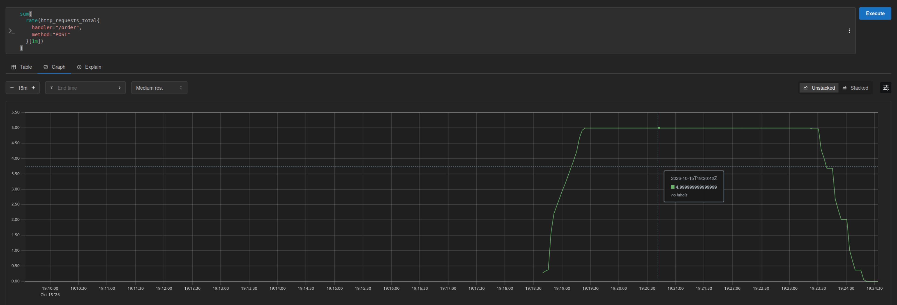

График, что 4хх и 5хх у нас нулевые:

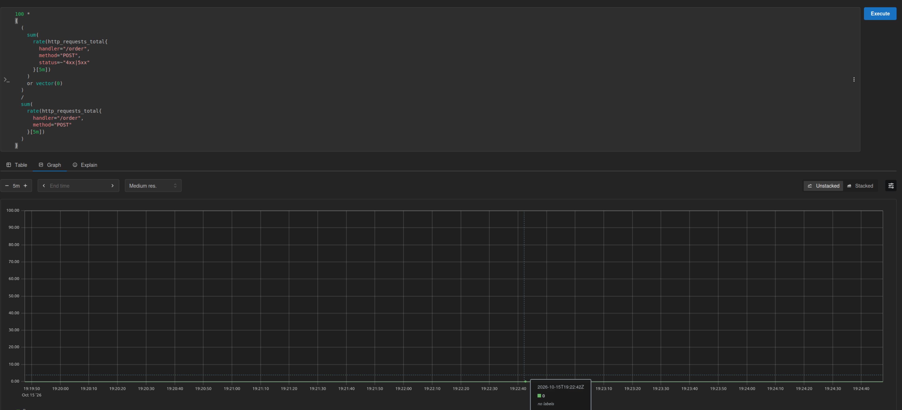

График, что p95 < 300 мс:

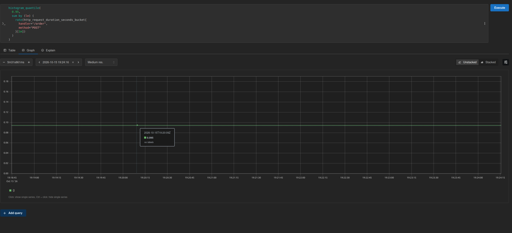

Ну и деградация batch (5 реплик всего запущено на нагрузку кластера):

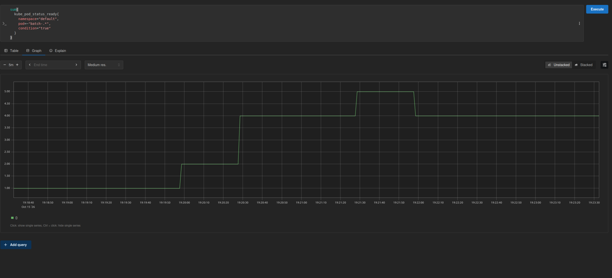

Отчет hey:

```bash
➜  lab4 git:(feat/lr4) ✗ ~/go/bin/hey \
  -z 5m \ 
  -c 5 \
  -q 1 \
  -m POST \
  -T application/json \
  -d '{
    "phone_number": "+79991234567",
    "customer_name": "Load Test",
    "sku": "1234567",
    "quantity": 1
  }' \
  http://172.20.0.3:30082/order

Summary:
  Total:        300.0096 secs
  Slowest:      0.0636 secs
  Fastest:      0.0040 secs
  Average:      0.0064 secs
  Requests/sec: 4.9998
  
  Total data:   76500 bytes
  Size/request: 51 bytes

Response time histogram:
  0.004 [1]     |
  0.010 [1438]  |■■■■■■■■■■■■■■■■■■■■■■■■■■■■■■■■■■■■■■■■
  0.016 [56]    |■■
  0.022 [0]     |
  0.028 [2]     |
  0.034 [2]     |
  0.040 [0]     |
  0.046 [0]     |
  0.052 [0]     |
  0.058 [0]     |
  0.064 [1]     |


Latency distribution:
  10%% in 0.0047 secs
  25%% in 0.0052 secs
  50%% in 0.0059 secs
  75%% in 0.0071 secs
  90%% in 0.0083 secs
  95%% in 0.0096 secs
  99%% in 0.0122 secs

Details (average, fastest, slowest):
  DNS+dialup:   0.0000 secs, 0.0000 secs, 0.0013 secs
  DNS-lookup:   0.0000 secs, 0.0000 secs, 0.0000 secs
  req write:    0.0000 secs, 0.0000 secs, 0.0027 secs
  resp wait:    0.0062 secs, 0.0038 secs, 0.0609 secs
  resp read:    0.0001 secs, 0.0000 secs, 0.0010 secs

Status code distribution:
  [201] 1500 responses
```

Тут тоже видно что SLA выполняется.

## Часть 9. Мониторинг

Для мониторинга приложения используется `kube-prometheus-stack` из Лабы 2. [PrometheusRules](k8s/shop-chart/templates/prometheus-rules.yaml)

| Алерт | Условие | Назначение |
|---|---|---|
| `ApiHighLatencyP95` | p95 запросов `/order` превышает 300 мс в течение минуты | Обнаружение нарушения SLA по времени ответа |
| `ApiHighErrorRate` | Доля HTTP 5xx превышает 1% в течение минуты | Обнаружение ошибок при обработке заказов |
| `BatchEvicted` | За последние 5 минут обнаружен вытесненный batch-под | Контроль деградации фоновых задач при нехватке ресурсов |

Для управления алертами используется Alertmanager, а для их просмотра Karma.

Пример срабатывания алерта по вытеснению батча:

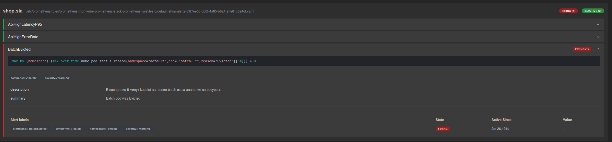

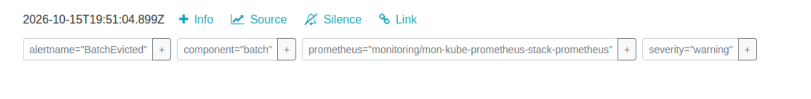

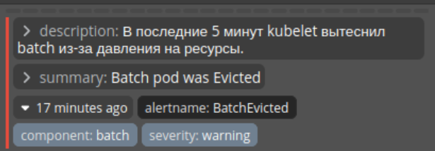