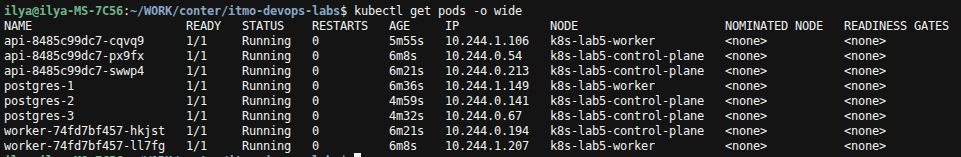
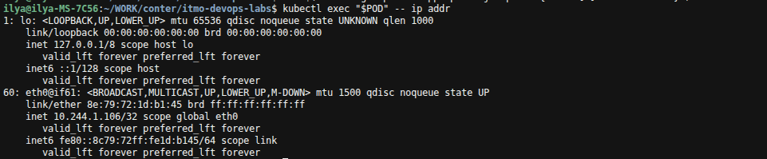
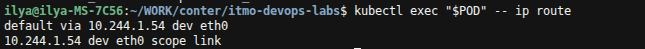
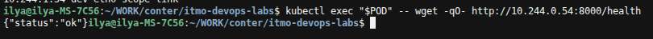
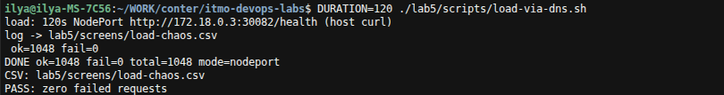
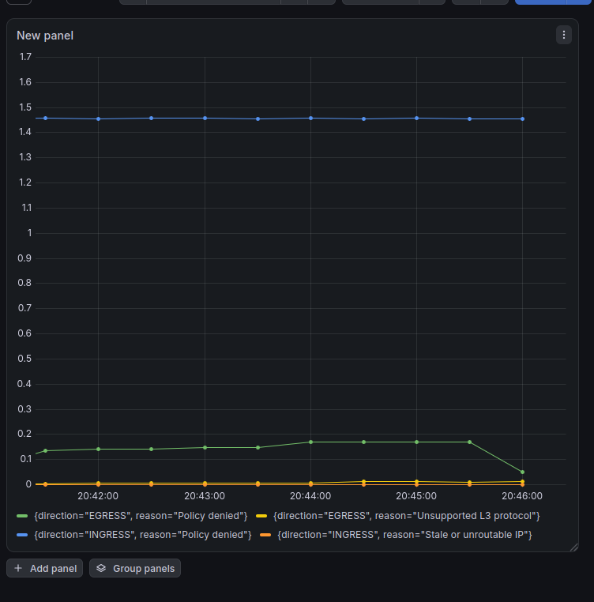
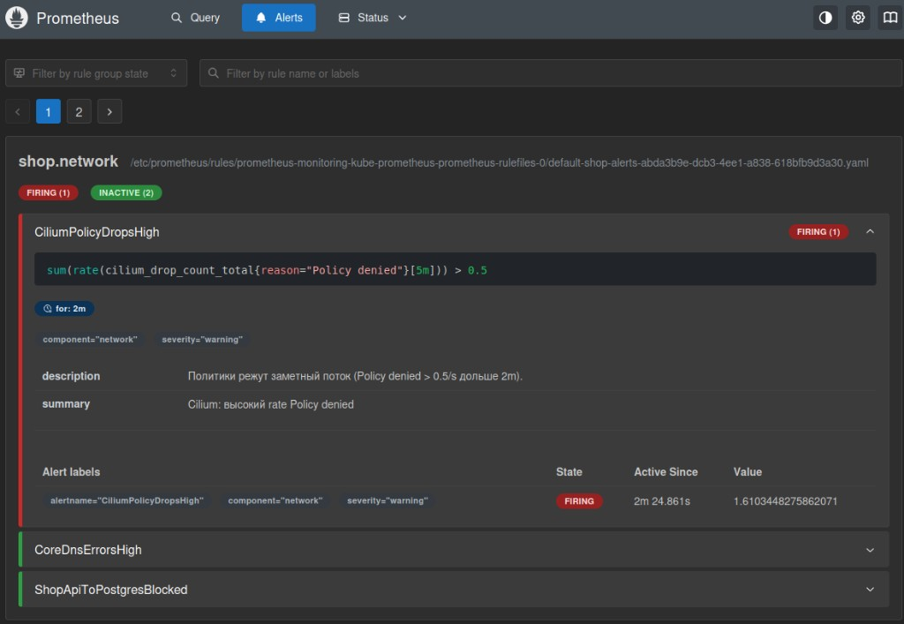

# Лаба 5 - Zero-trust сеть с доказательством

## Часть 0. Выбор CNI

**kind** - локальный Kubernetes в Docker. По умолчанию у него kindnet -  
простой встроенный сетевой плагин. Он NetworkPolicy принимает, но не применяет  
правило в кластере есть, а трафик всё равно ходит. Для zero-trust это бесполезно.

Выбрали Cilium, а не Calico, потому что

1. Cilium реально применяет NetworkPoliсy - правила начинают резать трафик
2. Есть Hubble - карта кто с кем общается и где пакеты дропаются. Это нужно в части 6

Calico политики тоже применяет, но готовой карты трафика как у Hubble нет диагностику пришлось бы собирать из логов/инструментов вручную 

---


## Часть 1. Кластер + сеть пода


### Поднять kind без kindnet

```bash
kind create cluster --name k8s-lab5 --config lab5/k8s/cluster-config.yaml
```

В [cluster-config.yaml](k8s/cluster-config.yaml) `disableDefaultCNI: true` kind не ставит kindnet, чтобы потом поставить Cilium без конфликта

После создания поды вроде `coredns`могут висеть без сети это нормально, пока CNI не установлен

### Установили Cilium и развернули shop

```bash
cilium install
```

Cобрали образы `api:v5` и `worker:v2`положили образы в ноды kind (иначе кластер полезет в интернет)

Поставили Kyverno + политики, CloudNativePG, kube-prometheus-stack/ Развернули api/worker/postgres

Сняли taint с control-plane, чтобы поды жили на обеих нодах (нужно для проверки сети между нодами)

Проверка: api/worker Running, `/health` отвечает

### Исследование сети пода



Поды `api` / `worker` / `postgres` размазаны по двум нодам
(`k8s-lab5-control-plane` и `k8s-lab5-worker`), у каждого свой IP вида `10.244.x.x`

**eth0 внутри пода** (`kubectl exec ... -- ip addr`)



- интерфейс `eth0@if61` - это конец **veth** (виртуальный кабель: один конец в поде, второй на ноде; `if61` - номер парного конца на ноде);
- IP пода: `10.244.1.106/32`.

**Маршрут** (`ip route`)



- default через `10.244.1.54` по `eth0` (шлюз на стороне ноды)

**Связь между нодами по IP** (минуя Service)



Из пода на worker (`10.244.1.106`) запрос на api на control-plane (`10.244.0.54:8000/health`) `{"status":"ok"}`.

**Вывод** сеть Kubernetes из коробки плоская, любой под достучится до любого по IP, даже на другой ноде, без Service.

---


## Часть 2. Непрерывность через хаос подов


### Как клиент входит в api

В [values.yaml](k8s/shop-chart/values.yaml) у api стоит `service.type: NodePort`, порт `30082`

**NodePort** - на каждой ноде открыт один и тот же порт. Запрос на IP любой ноды:`30082` попадает в Service и дальше в живые поды api.

**LoadBalancer** - в облаке снаружи появляется один публичный IP балансировщика, а за ним обычно тот же Service/NodePort. В kind настоящего LoadBalancer нет без доп. софта.

**Headless** (`ClusterIP: None`) - у сервиса нет виртуального IP: DNS сразу отдаёт IP подов. Так делают, когда клиент сам выбирает инстанс

### Как гоняли доказательство

Параллельно: [chaos-pods.sh](scripts/chaos-pods.sh) (убивает поды api) и [load-via-dns.sh](scripts/load-via-dns.sh) (гоняет запросы на Service через NodePort).

```bash
./lab5/scripts/chaos-pods.sh
DURATION=120 ./lab5/scripts/load-via-dns.sh
```

Сначала ловили fail из-за плохого замера: ходили через `kubectl exec` в те же поды, которые хаос убивал, и ещё слишком быстро сносили реплики. Когда нагрузку перевели на обычный `curl` через NodePort, а хаос стал ждать Ready и давать поду время сняться с балансировки (`preStop`), получилось **1048 ok / 0 fail** - клиент не замечает смену IP подов.



Лог: [load-chaos.csv](screens/load-chaos.csv).

### Почему клиент не падает

**DNS** внутри кластера переводит имя `api` в ClusterIP сервиса  
**Service** даёт стабильный виртуальный адрес и выбирает поды по лейблу `app=api`  
**EndpointSlice** хранит IP только **готовых** подов, умершие из списка выкидываются  
**kube-proxy** на ноде раскладывает правила, пакет в Service уходит в один из готовых подов  
**NodePort** с хоста IP ноды + порт `30082` попадает в тот же Service

**Режим kube-proxy**

```bash
kubectl -n kube-system get cm kube-proxy -o yaml | grep 'mode:'
```

Там `mode: iptables` kube-proxy раскладывает куда слать пакеты Service через обычные iptables правила Linux. Есть ещё режим IPVS  - удобнее на очень больших кластерах с кучей сервисов, нам хватает iptables.

---


## Часть 3. Целевая матрица доступа

Сейчас сеть **плоская**, любой под может достучаться до любого.  
Zero-trust наоборот, **по умолчанию нельзя**, открываем только нужные связи.

### Целевая матрица

строка откуда идем в столбце куда


| откуда куда                     | api | postgres | DNS | worker |
| ------------------------------- | --- | -------- | --- | ------ |
| **клиент (с хоста / NodePort)** | +   | -        | -   | -      |
| **api**                         | -   | +        | +   | -      |
| **worker**                      | -   | +        | +   | -      |
| **чужой под**                   | -   | -        | +   | -      |
| **postgres**                    | -   | +        | +   | -      |


реплики Postgres ходят друг к другу для своей работы (CloudNativePG)

снаружи только api, до базы - только api и worker; DNS нужен всем, кто ходит по именам сервисов.

---


## Часть 4. Zero-trust через NetworkPolicy

**NetworkPolicy** - правило кто к кому может ходить по сети. Cilium его реально применяет

В чарте (`networkPolicies.enabled: true` в [values.yaml](k8s/shop-chart/values.yaml)) пять политик:

1. [networkpolicy-default-deny.yaml](k8s/shop-chart/templates/networkpolicy-default-deny.yaml) - по умолчанию нельзя ничего
2. [networkpolicy-allow-dns.yaml](k8s/shop-chart/templates/networkpolicy-allow-dns.yaml) - можно ходить в DNS (чтобы имена сервисов находились)
3. [networkpolicy-api.yaml](k8s/shop-chart/templates/networkpolicy-api.yaml) - снаружи можно в api, а api можно в postgres
4. [networkpolicy-worker.yaml](k8s/shop-chart/templates/networkpolicy-worker.yaml) - worker можно в postgres
5. [networkpolicy-postgres.yaml](k8s/shop-chart/templates/networkpolicy-postgres.yaml) - в базу пускаем только api и worker (еще оператор и реплики postgres между собой)

После `helm upgrade` shop живой: `/health` ок

---


## Часть 5. Матрица на практике

Подняли чужой под [stranger-pod.yaml](k8s/stranger-pod.yaml) (обычный nginx, не api/worker) и прогнали [check-matrix.sh](scripts/check-matrix.sh).

Скрипт из разных мест пытается достучаться до целей и пишет `ok` или `blocked`:

- с **хоста** - `curl` на NodePort api
- из **api** и **worker** -  Python-код открыть TCP к postgres
- из **stranger** - `wget` к postgres и к api (в этом поде нет Python)
- отдельно проверяет, что api может узнать IP имени `postgres-rw` через DNS

Потом сравнивает с ожиданием, если всё совпало - `окей`.

```bash
kubectl apply -f lab5/k8s/stranger-pod.yaml
./lab5/scripts/check-matrix.sh
```


|                       | ожидаемо | фактически |
| --------------------- | -------- | ---------- |
| хост (NodePort) к api | ok       | ok         |
| api к postgres        | ok       | ok         |
| worker к postgres     | ok       | ok         |
| stranger к postgres   | blocked  | blocked    |
| stranger к api        | blocked  | blocked    |
| api к DNS             | ok       | ok         |


**окей:** разрешённое работает, запрещённое - нет.

---


## Часть 6. Скрытая поломка

**Hubble** - карта трафика Cilium. видно, кто с кем говорит и где пакет **DROPPED**

```bash
export PATH="$HOME/.local/bin:$PATH"
cilium hubble enable
cilium status --wait
cilium hubble port-forward
```


### Скрипты

- [demo-break.sh](scripts/demo-break.sh) - поломка + матрица + Hubble
- [break-network.sh](scripts/break-network.sh) - `helm upgrade` с overlay-поломкой
- [check-matrix.sh](scripts/check-matrix.sh) - кто к кому ok / blocked
- [hubble-drops.sh](scripts/hubble-drops.sh) - DROPPED на :5432 и DNS :53
- [fix-network.sh](scripts/fix-network.sh) - откат политик и проверка

```bash
./lab5/scripts/demo-break.sh wrong-port
./lab5/scripts/fix-network.sh
```


### Пример 1 `wrong-port`

В политике разрешён порт `9999`, приложение ходит на `5432`.

```text
=== матрица (фактически) ===
host/NodePort  -> api         expected=ok        actual=ok
api            -> postgres    expected=ok        actual=blocked
worker         -> postgres    expected=ok        actual=blocked
stranger       -> postgres    expected=blocked   actual=blocked
stranger       -> api         expected=blocked   actual=blocked
api            -> DNS         expected=ok        actual=ok
не окей

=== DROPPED api/worker -> :5432 ===
... api-... <> postgres-1:5432 ... EGRESS DENIED ...
... api-... <> postgres-1:5432 ... Policy denied DROPPED ...
... worker-... <> postgres-1:5432 ... EGRESS DENIED ...
... worker-... <> postgres-1:5432 ... Policy denied DROPPED ...

=== DROPPED -> DNS :53 ===
(нет)
```

режется выход к postgres на **5432**, DNS живой

### Пример 2 `wrong-label`

В allow указан неверный лейбл кластера postgres. Матрица: api/worker к postgres blocked, DNS ok. В Hubble снова DROPPED на :5432 (политика не видит настоящие поды). DNS без дропов. Отличие от wrong-port - в YAML политик (лейбл, а не порт)

### Пример 3 `no-dns`

Выключен allow-dns. Матрица api к DNS = blocked (postgres тоже часто blocked - имя не резолвится). В Hubble дропы **:53** к CoreDNS (`EGRESS DENIED` UDP), блок :5432 может быть пустым

### Пример 4 `no-clients`

У postgres пустой список клиентов. Матрица api/worker к postgres blocked, DNS ok. Связь режется на **входе** к postgres (ingress), не на DNS

После экспериментов Postgres один раз «упал» на failover/initdb (не мог достучаться до API Kubernetes). Добавили [ciliumnetworkpolicy-kube-apiserver.yaml](k8s/shop-chart/templates/ciliumnetworkpolicy-kube-apiserver.yaml). Матрица снова окей.

---


## Часть 7. Мониторинг

Стек из лабы 2, новый не поднимали. Включили scrape метрик Cilium/Hubble (`cilium upgrade` + ServiceMonitor с `release: mon`). В чарте: [api-servicemonitor.yaml](k8s/shop-chart/templates/api-servicemonitor.yaml), [worker-servicemonitor.yaml](k8s/shop-chart/templates/worker-servicemonitor.yaml), [prometheus-rules.yaml](k8s/shop-chart/templates/prometheus-rules.yaml).

Дашборд (дропы Cilium по `reason` / `direction`):



### Три алерта

Правила в [prometheus-rules.yaml](k8s/shop-chart/templates/prometheus-rules.yaml). Каждый ждёт `for: 2m`, чтобы не дёргаться от короткого всплеска.

`CiliumPolicyDropsHigh` - если Cilium режет пакеты с причиной `Policy denied` быстрее чем ~0.5 в секунду дольше двух минут. Это общий сигнал: политики слишком жёсткие или кто-то ошибся в правилах (неверный порт, лейбл, пустой список клиентов).

`CoreDnsErrorsHigh` - если больше 5% ответов CoreDNS не `NOERROR` дольше двух минут. Без нормального DNS сервисы не находятся по имени - в zero-trust это отдельная частая поломка (забыли allow-dns).

`ShopApiToPostgresBlocked` - если растут именно **исходящие** (EGRESS) дропы `Policy denied` (> ~0.2/s). Ближе к симптому «приложение не может достучаться наружу» (часто api/worker -> postgres), а не любой дроп в кластере.

Спровоцировали `wrong-port` и загорелся `CiliumPolicyDropsHigh` (firing, value ~ 1.6).  
`ShopApiToPostgresBlocked` остался inactive дропы часто считаются на стороне приёмника как **INGRESS**, а этот алерт смотрит только **EGRESS**.

