# Лаба 7 (или 8) -- Автоматизация devops-процесса с n8n + AI

>
> Я так и не понял какая это лаба по счёту...
>

Прочитали мелким шрифтом о индивидуальной лицензии, и устанавливаем образы для того чтобы поднять n8n локально

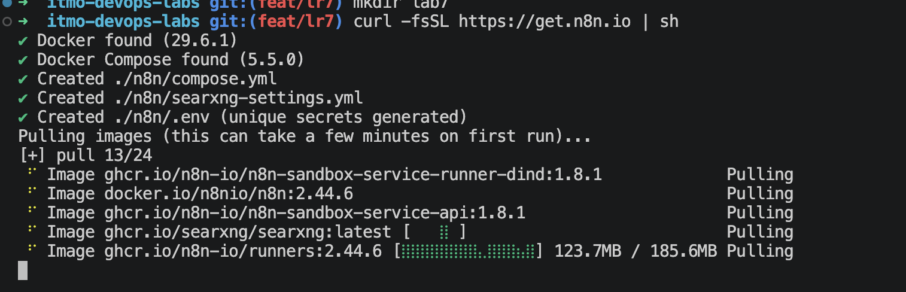

>
> Было время когда n8n cloud можно было использовать и обычным людям.. видимо теперь это время прошло -- теперь там только компании
>

## Часть 1 -- Наш кейс

Хотелось бы связать что-нибудь с безопасностью и пришла такая идея -- ежесуточная автопроверка актуальности TLS-сертификата и отправка уведомления, в случае его компроментации или истечения его срока.

Данная автоматизация будет актуальна как для стартапов, так и для крупных проектов. У всех них есть свои публичные домены с выпущенными сертификатами, и их проверка будет крайне полезна.

- **Кому помогает?** Дежурному devops-инженеру (а косвенно -- всем сотрудникам и клиентам, так как у них не падает сайт с ошибкой сертификата).
- **Какую проблему решает?** Сертификаты и регистрация доменов истекают незаметно: certbot может тихо сломаться (сменился DNS, не хватило прав). Проверять руками десяток доменов каждый день никто не будет, а когда сертификат уже истёк -- это инцидент с простоем. Отдельно опасна ситуация, когда сертификат кто-то выпустил на наш домен без нашего ведома (компрометация).
  
- **Что делает автоматизация?**

  1) **Триггер** (раз в сутки в 09:00 или ручной запуск GET-запросом -- фактически, это вебхук)
  2) **Быстрая проверка** TLS без ИИ (code-нода сама ходит по списку доменов и считает дни до истечения)
  3) Если всё хорошо -- ничего не делаем, так экономятся токены.
  4) Если есть проблемы --  происходит запуск агента, он подтверждает факт через настроенные инструменты, классифицирует (critical / warning / info), через MCP сохраняет отчёт в файл и заводит issue в GitHub
  5) Отправка статус-сообщения дежурному на почту

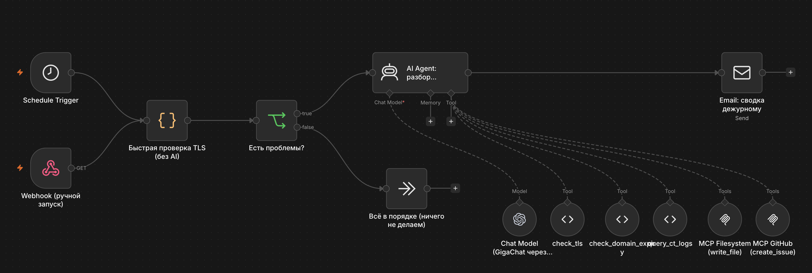


## Часть 2 -- AI-инструменты и компоненты схемы

> В качестве модели выбран GigaChat, так как у него единственного есть беспалтный тариф. Чтобы найти что-то за бесплатно пришлось потратить кучу времени...  
> 
> Сначала я пытался подключить community-ноду `n8n-nodes-gigachat`, но её нельзя соединить с блоком AI-Agent. Поэтому рядом поднимаем контейнер gpt2giga -- прокси-сервер, сам получающий и обновляющий токен авторизации.   n8n видит его как обычный OpenAI-совместимый API.
> 
> Изначально уведомления уходили в Telegram, но лаба делает на корпоративном маке, и поэтому нет возможности достучаться до их сайта. Поэтому итоговая сводка отправляется на почту Mail нодой `Send Email` через SMTP сервер Яндекса
### Чек-лист требований

- [ ] **Триггер** -- `Schedule Trigger` (каждый день в 9:00) и `Webhook` (`/webhook/tls-watch`) для ручного запуска
- [ ] **AI и не-AI шаги**
  - [ ] не-AI: code-нода «Быстрая проверка TLS», ,блок `IF`, `Send Email`
  - [ ] AI: нода `AI Agent` с моделью GigaChat-2-Max (Сбер) через прокси gpt2giga
- [ ] **Минимум два MCP-сервера**
  - [ ] `mcp-filesystem` -- запись отчёта
  - [ ] `mcp-github` -- создание issue
- [ ] **AI toolkit на 3-5 инструментов** -- 5 инструментов (см. ниже)
- [ ] **Skills** -- [skills/tls-incident-triage/SKILL.md](skills/tls-incident-triage/SKILL.md)
- [ ] **Конкретный результат**
  - [ ] файл отчёта `data/reports/YYYY-MM-DD.md`
  - [ ] issue в GitHub
  - [ ] письмо дежурному на почту

### Шаги в workflow

- [ ] **Schedule Trigger / Webhook** -- два входа в один и тот же процесс
- [ ] **Быстрая проверка TLS (без AI)** -- code-нода с модулем `tls`
  - [ ] для каждого домена из списка открывает TLS-соединение
  - [ ] собирает: валиден ли сертификат, кто издатель, сколько дней осталось
  - [ ] на выходе -- список «подозрительных» доменов (`problems`) и флаг `hasProblems`
  
- [ ] **Есть проблемы?** -- `IF` по флагу `hasProblems`
  - [ ] ветка «нет» -- процесс заканчивается здоровые прогоны не стоят ни токена
  
- [ ] **AI Agent: разбор инцидентов**
  - [ ] системный промпт -- это skill из `SKILL.md`
  - [ ] агент сам решает, какие из представленных инструментов и в каком порядке вызывать
- [ ] **Send Email** -- итоговое письмо дежурному на почту (формат описан в skill)

### Набор инструментов

- [ ] **`check_tls`**
  - Повторно проверяет TLS-сертификат домена (подтверждение находки)
  - Вход: строка с именем хоста, например `example.com`
  - Выход: JSON -- валидность, ошибка, издатель, срок, дни до истечения, отпечаток
- [ ] **`check_domain_expiry`**
  - Узнаёт срок регистрации домена через RDAP
  - Вход: строка с apex-доменом, например `example.com`
  - Выход: JSON с датой истечения и днями до неё
- [ ] **`query_ct_logs`** (Code Tool)
  - Ищет в логах Certificate Transparency (crt.sh) свежие сертификаты на хост и отмечает выпуски от неожиданных издателей
  - Вход: строка `host` или `host,hours` (по умолчанию 24 часа)
- [ ] **`write_file`** (MCP Filesystem)
  - Сохраняет Markdown-отчёт в `/data/reports/YYYY-MM-DD.md`
  - Вход: `path`, `content`
- [ ] **`create_issue`** (MCP GitHub)
  - Что делает: создаёт issue в тестовом репозитории
  - Вход: `owner`, `repo`, `title`, `body`

### MCP-серверы
- [ ] `@modelcontextprotocol/server-filesystem`
- [ ] `@modelcontextprotocol/server-github`
 
n8n подключается нодой `MCP Client Tool` по адресам `http://mcp-filesystem:8000/sse` и `http://mcp-github:8000/sse`

Агент имеет миниальные привелегии:
- из каждого сервера агенту отдаётся только один нужный инструмент
- агент не сможет, например, удалить файл или закрыть чужой issue
- файловому серверу доступна только папка `./data`

### Скиллы

Один самописный скилл, который описывает:

- [ ] **Порядок действий**
  - [ ] подтвердить каждую находку через `check_tls`
  - [ ] для apex-доменов вызвать `check_domain_expiry`
  - [ ] при подозрительной причине сходить в `query_ct_logs`
  - [ ] классифицировать
  - [ ] сохранить отчёт
  - [ ] завести issue
  - [ ] вернуть итог
  
- [ ] **Классификация**
  - [ ] critical -- сертификат истёк / не проходит проверку / домен истёк / чужой выпуск в CT-логах
  - [ ] warning -- 14 дней и меньше до истечения
  - [ ] info -- плановая смена при ожидаемом издателе

- [ ] **Ограничения**
  - [ ] Не делать вывода без подтверждения tool'ом
  - [ ] Не более одного issue на домен
  - [ ] Ошибки tool'ов попадают в отчёт, а не выдумываются
  - [ ] Инф-ру агент не трогает -- только рекомендует
  
- [ ] **Runbook** -- краткий лежит в skill, расширенная версия в `data/runbook.md`

>
> Как оказалось, n8n не умеет подтягивать файл skill'а сам, поэтому он `SKILL.md` продублирован в системном сообщении ноды агента
> 

## Часть 3 -- Локальный запуск

### Стек

Всё поднимается одним `docker-compose.yml`: n8n, два MCP-сервера, прокси gpt2giga (доступ к GigaChat), blackbox-exporter, Prometheus, Grafana.

### Алгоритм запуска

1. Скопировать `.env.example` в `.env` и заполнить `GITHUB_PERSONAL_ACCESS_TOKEN` (fine-grained токен на тестовый репозиторий с правом Issues: Read and write), `GIGACHAT_CREDENTIALS` (Authorization key из [кабинета разработчика Сбера](https://developers.sber.ru/)) и `GPT2GIGA_API_KEY` (любой длинный случайный секрет).
2. Поднять стек:

```
docker compose up -d
```

3. Открыть n8n на `http://localhost:5678`, создать владельца.
4. Импортировать [workflow.json](workflow.json) (Workflows -> Import from file).
5. Создать креды и выбрать их в нодах:
   - `OpenAI` -- API Key = значение `GPT2GIGA_API_KEY` из `.env`, Base URL = `http://gpt2giga:8090/v1` (ключ Сбера в n8n не нужен, его знает только прокси);
   - `SMTP` для ноды «Email» -- Яндекс: хост `smtp.yandex.ru`, порт `465`, SSL/TLS включён, логин -- полный адрес, пароль -- «пароль приложения» (Яндекс ID -> Безопасность -> Пароли приложений -> Почта). В ноде адрес отправителя должен совпадать с логином, получатель -- любой (у меня почта на mail.ru).
6. Запустить workflow: кнопка `Execute workflow` либо `curl http://localhost:5678/webhook-test/tls-watch`.


### Подготовка тестовых данных

Вместо реальных ресурсов был использован сервис `badssl.com`, на котором специально лежат сломанные сертификаты:

| Домен | Что с ним не так | Ожидаемая классификация |
| --- | --- | --- |
| `expired.badssl.com` | сертификат истёк | critical |
| `self-signed.badssl.com` | самоподписанный | critical |
| `wrong.host.badssl.com` | сертификат выдан на другое имя | critical |
| `untrusted-root.badssl.com` | недоверенный корневой CA | critical |
| `example.com` | всё в порядке | не попадает в `problems` |


Произведем запуск сценария. Для этого выполним GET-запрос на `http://localhost:5678/webhook-test/tls-watch`

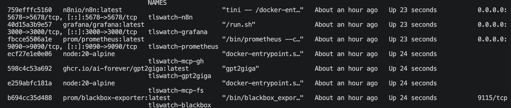

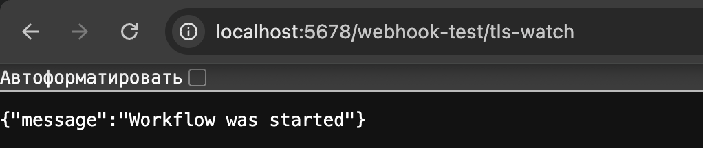

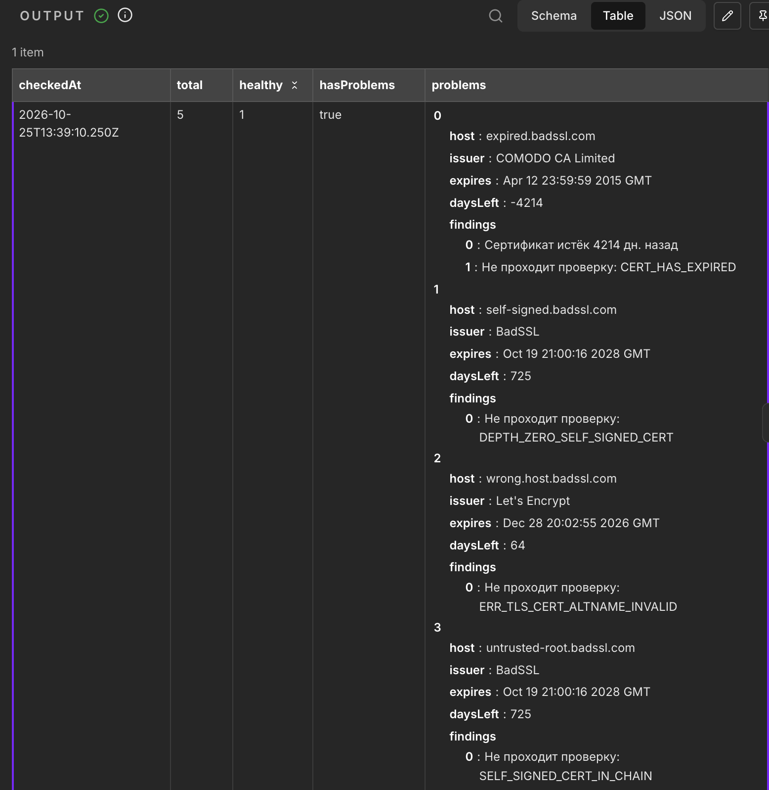

> Результат работы ноды «Быстрая проверка TLS» не удалась -- выявлены проблемы с сертификатами у большей части доменов

### Прогон агента

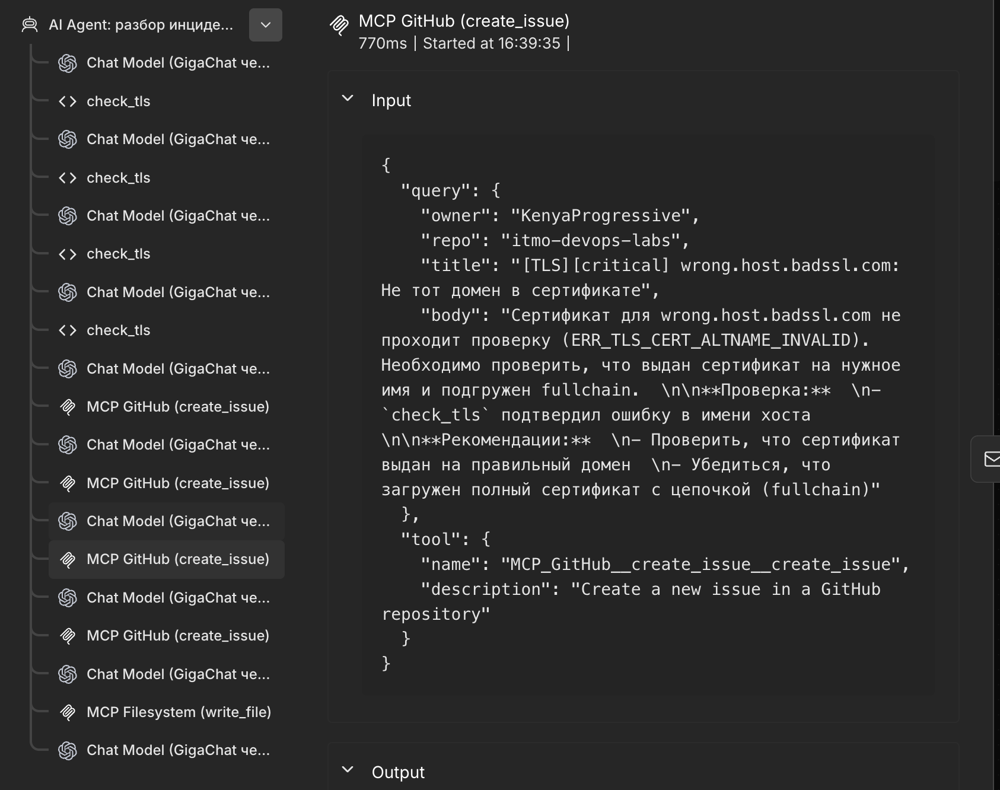

Файл отчёта `data/reports/<дата>.md`, созданный через MCP Filesystem

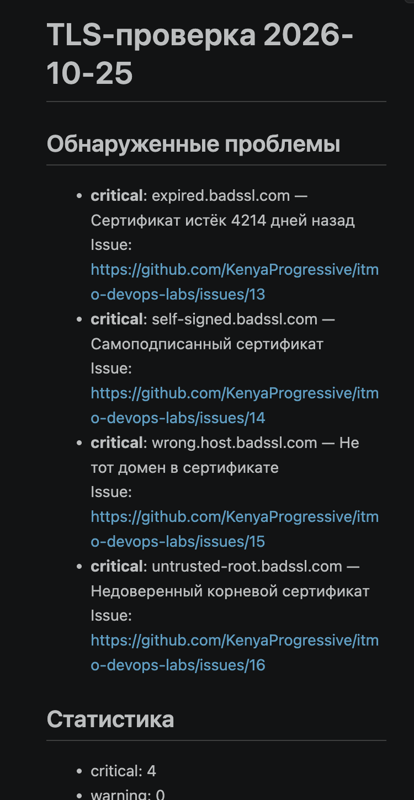


Issues, созданные через MCP GitHub (по одному на домен)

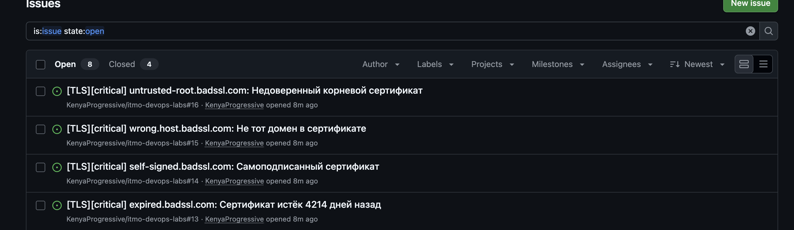

> Итоговое письмо дежурному в почтовом ящике

### Ветка «всё хорошо»

Если из списка убрать сломанные домены, блок `IF` выдаст `hasProblems=False` и агент не вызывается => токены не тратятся.

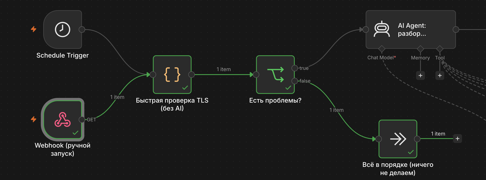

## Часть 4 -- Мониторинг

### Prometheus

n8n умеет отдавать метрики в формате Prometheus сам (`N8N_METRICS=true`, эндпоинт `/metrics`), поэтому для него отдельный экспортер не нужен. А вот сами сертификаты наш workflow проверяет только раз в сутки и только своим кодом. Чтобы иметь **независимый** взгляд, добавлен **blackbox-exporter**: Prometheus просит его сходить на каждый домен и вернуть результат пробы.

В blackbox настроены два модуля:

- `http_2xx` -- строгая проверка HTTPS. Невалидный сертификат даёт `probe_success = 0`.
- `tcp_tls` -- только рукопожатие, без проверки доверия. Нужен, чтобы прочитать срок сертификата (`probe_ssl_earliest_cert_expiry`) даже у «плохих» доменов, у которых строгий модуль просто упал бы.

В Prometheus три job'а: `n8n` (метрики самого n8n), `tls-expiry` (модуль `tcp_tls`) и `https` (модуль `http_2xx`).

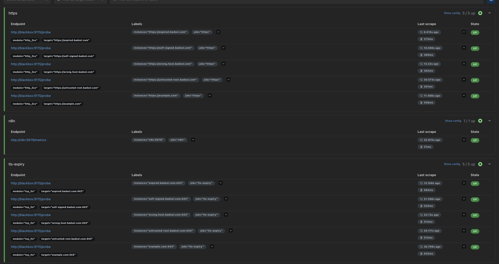

### Grafana

Дашборд «TLS Watch» в Grafana. Выбранные панели:

1. **Дней до истечения сертификата** -- главная панель кейса: по цветам сразу видно, где срок сертификата уже подходит к концу.
2. **HTTPS-пробы: доступность** -- 1/0 по каждому домену.
3. **Запуски workflow за час: успех / ошибки** -- работает ли сам наблюдатель.
4. **Длительность HTTPS-проб** -- деградация эндпоинтов до того, как они упадут совсем.
5. **Успешных запусков за 26 ч** -- «пульс» наблюдателя.
6. **Память процесса n8n**
7. **CPU процесса n8n**

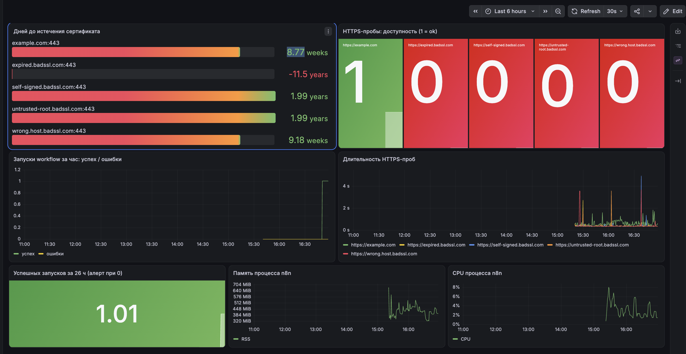

### Три метрики для алертов

Правила лежат в [prometheus/alerts.yml](prometheus/alerts.yml).

**1. `probe_ssl_earliest_cert_expiry` -- сертификат скоро истечёт (warning)**

```
(probe_ssl_earliest_cert_expiry{job="tls-expiry"} - time()) / 86400 < 14
```

Именно истёкший сертификат ломает сайт у клиентов. Порог 14 дней оставляет время починить сломавшийся certbot без паники (Let's Encrypt обычно обновляет за 30 дней, значит, если осталось 14 -- автообновление уже не отработало хотя бы дважды). `for: 5m` защищает от единичных сбоев пробы.

**2. `probe_success` -- HTTPS-проба не проходит (critical)**

```
probe_success{job="https"} == 0
```

Покрывает всё, что видит пользователь: недоступность, невалидную цепочку, не то имя в сертификате. Эта метрика не зависит от n8n -- если сломался наш workflow, алерт всё равно придёт. Критичность высокая: это уже прямое влияние на клиентов.

**3. `n8n_workflow_success_total` -- наблюдатель молчит (critical)**

```
sum(increase(n8n_workflow_success_total[26h])) < 1 or absent(n8n_workflow_success_total)
```

«Кто сторожит сторожа». Если n8n упал, завис, или расписание перестало срабатывать, мы перестанем получать уведомления и будем думать, что всё хорошо -- самый опасный вид отказа. Окно 26 часов = сутки + запас на задержку. Условие `absent(...)` ловит случай, когда метрики нет совсем (n8n не поднялся).

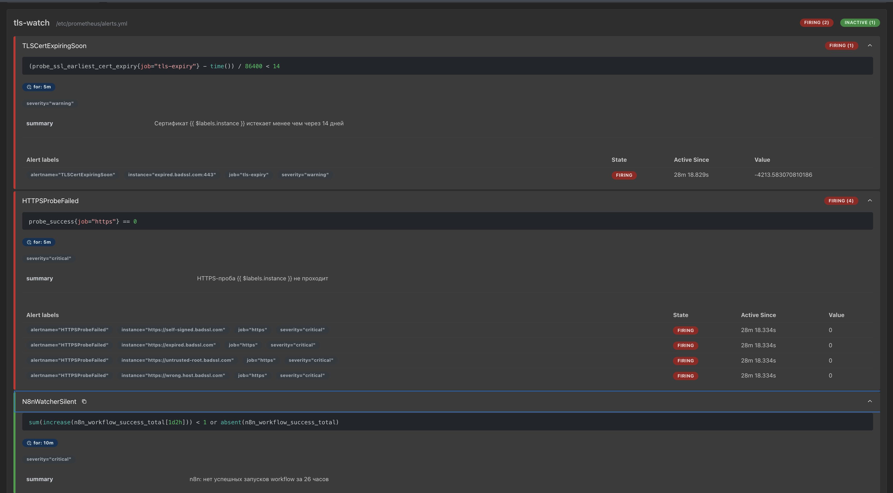

Ну и сообщение на почту напоследок :)

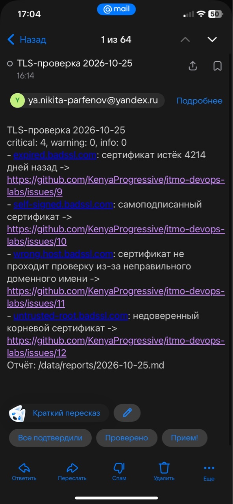

# Спасибо за прекрасный предмет! 